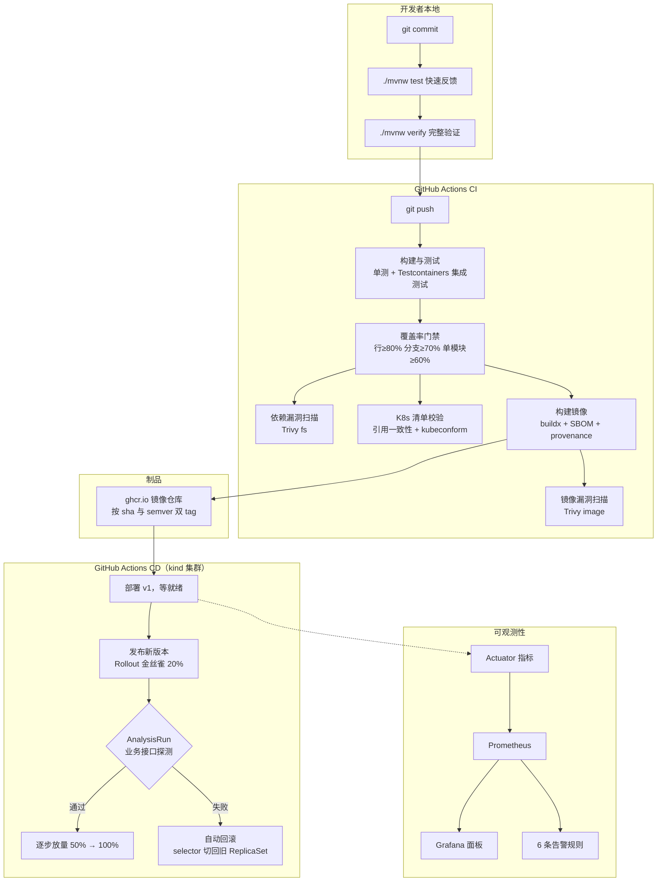

# 00 全景：从 `git push` 到生产回滚，一图看懂

> 这是整个仓库的地图。每一环展开都有独立文档，链接见各节。

## 一条 commit 的完整旅程



## 各环节的关键取舍（30 秒版）

| 环节 | 关键取舍 | 文档 |
|---|---|---|
| 模块划分 | 自定义父 POM 而非继承 starter-parent，代价是必须自己补插件治理 | [01-local-dev](01-local-dev.md) |
| 测试 | 集成测试用真实 PostgreSQL（Testcontainers）而非 H2 | [02-testing](02-testing.md) |
| 镜像 | 多阶段自包含构建，代价是层缓存覆盖不到依赖下载 | [03-docker](03-docker.md) |
| CI | 门禁必须「不会被绕过」：ignore-unfixed、覆盖率分包卡 | [04-cicd](04-cicd.md) |
| 部署 | liveness 不含数据库检查；preStop 补 Endpoints 传播窗口 | [05-kubernetes](05-kubernetes.md) |
| 发布 | 金丝雀判定用 Job 而非 Prometheus（无流量时后者会假失败） | [06-canary-rollback](06-canary-rollback.md) |
| 观测 | `_created` 是保留后缀；直方图不打开则 p99 永不触发 | [07-observability](07-observability.md) |
| 合规 | digest 部署、SBOM、审批门、expand/contract | [08-banking-devops](08-banking-devops.md) |
| 面试 | 怎么把上面这些讲成一个故事 | [09-interview-playbook](09-interview-playbook.md) |

## 一页纸全貌

```
仓库结构
├── demo-common     ← 契约 DTO（不依赖 Web）
├── demo-core       ← 实体 + 仓储 + 服务（不认识 HTTP）
├── demo-api        ← 控制器 + 异常处理 + 指标
├── demo-coverage   ← 跨模块覆盖率聚合（无代码，只出报告）
├── k8s/            ← Kustomize base + dev/prod/ci overlays + Rollout
├── observability/  ← Prometheus 配置 + 告警规则 + Grafana
├── scripts/        ← 覆盖率门禁 + K8s 引用一致性检查
├── Dockerfile      ← 多阶段构建
├── docker-compose.yml ← 本地一键全栈
└── .github/workflows/ ← ci.yml（5 job）+ cd.yml（金丝雀演示）

链路
  commit → verify（75 个测试）→ 覆盖率门禁 → Trivy 扫描
        → 镜像 + SBOM + provenance → GHCR
        → kind 集群 → 金丝雀 20% → AnalysisRun 判定
        → 成功：放量至 100% / 失败：自动回滚

数字
  覆盖率　行 92.3% / 分支 88.1%（门禁 80% / 70%）
  测试数　75（单测 59 + 集成 10 + 其它 6）
  镜像　　286MB（非 root，JRE 21）
  回滚　　秒级（selector 切换，MTTR 的关键）
```

## 三个验证入口

```bash
# 1. 本地全量验证（含 Testcontainers 起真实 PostgreSQL）
./mvnw verify

# 2. 本地全栈运行（应用 + 库 + Prometheus + Grafana）
docker compose up -d --build

# 3. K8s 清单静态校验（不需要集群）
python3 scripts/check-k8s-manifests.py
```

前两个每次改代码后都应该跑；第三个由 CI 强制执行。